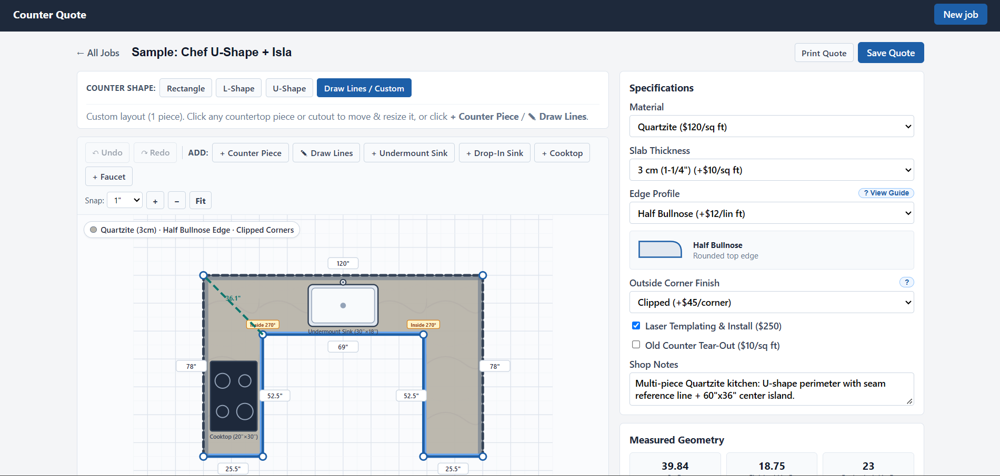
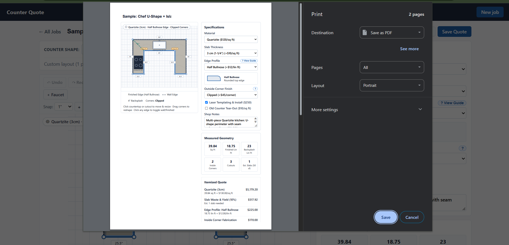

# Answers

- **Name:** Dasari Kalyan
- **Email** (the one you applied with): kalyandasari272@gmail.com
- **Phone** (optional): 7799644557

## 1. What did you need to research, and how did you do it?

I researched how stone countertop fabricators estimate jobs in practice — specifically how shops combine square-foot material + fabrication rates, linear-foot edge profile upgrades, cutout fees, inside corner relief/seaming, slab length limits, and backsplash charges:
- **Square-foot pricing, slab yield & seam length:** Most shops quote installed base rates per sq. ft. by stone type and thickness (2cm vs. 3cm), factor in ~10% slab yield/waste, apply a minimum job charge for small vanities, and flag runs exceeding ~120" (standard slab length) for field seams.
- **Edges & corners:** Standard eased edges are typically included in the base rate, while upgraded profiles (Half Bullnose, Bevel, Full Bullnose, Ogee, Mitered) add per-linear-foot charges *only on finished/exposed edges* (never against walls). Concave inside corners (in L- and U-shapes) require CNC radius relief or precision seams, and non-90° walls add templating/setup complexity.
- **Cutouts & backsplashes:** Undermount sinks cost more than drop-ins because the interior rim must be CNC-polished; cooktops and core-drilled faucet holes are billed per cutout; matching 4" backsplashes are billed per linear foot along wall edges.
- References consulted:
  - Craft Counters — Countertop pricing & cutout/edge breakdown: https://craftcounters.com
  - SlabWise — Stone fabrication inside corner radius & complexity quoting: https://slabwise.com

## 2. How did you decide what to charge for, and how?

I built a single transparent, itemized pricing model in both [QuoteCalculator.cs](backend/CounterQuote.Api/Services/QuoteCalculator.cs) (authoritative on save) and [quote.ts](frontend/src/quote.ts) (instant live preview while drawing):
- **Material & thickness:** Granite ($68/sf), Quartz ($82/sf), Marble ($108/sf), Quartzite ($120/sf), plus +$10/sf for 3cm slabs vs. 2cm, plus a 10% slab waste & yield factor (with an estimated 50 sq. ft. usable slab count).
- **Finished edges vs. walls:** Only edges marked *Finished* are multiplied by the selected edge profile upcharge (Eased $0, Half Bullnose $12/lf, Bevel $14/lf, Full Bullnose $18/lf, Ogee $28/lf, Mitered $42/lf). Edges marked *Wall* can toggle a 4" matching backsplash ($22/lf).
- **Corners:** Automatically detected from the polygon geometry — concave inside corners ($85 each), exposed finished outside corner upgrades (Standard $0, Radius $35, Clipped $45), and non-90° angled corners ($65 each).
- **Cutouts & shop services:** Undermount Sink ($185), Drop-In Sink ($110), Cooktop ($165), Faucet Hole ($25), optional Laser Templating & Install ($250 flat), optional Old Counter Tear-Out ($10/sf), and a $550 shop minimum.

## 3. How did you use AI? Where did it help, and how did you lead it?

AI helped accelerate boilerplate across the EF Core migration, SVG coordinate transforms (`getScreenCTM().inverse()`), bounding-box resize handles, and matching TypeScript/C# pricing rules. I led the architecture around a unified multi-piece 2D polygon + per-edge metadata + resizable cutout/line schema (`DesignJson`), verified the shoelace area and cross-product inside/angled-corner math against hand-calculated xUnit tests (`JobsControllerTests.cs`), and enforced server-side recalculation on `POST`/`PUT` so persisted quotes are always accurate.

## 4. What would you ask an industry expert to check or improve this?

- How their shop handles **slab nesting / whole-slab billing** when a layout slightly exceeds one slab (e.g., 52 sq. ft. requiring a second slab vs. billing remnant square footage).
- Whether **mitered waterfall legs** (which add vertical slab square footage plus a 45° mitered seam) and **overhang support brackets** (for breakfast bars >10–12") should be modeled as dedicated attachments.
- How often non-90° walls require digital laser-template tolerances or scribing allowances along wall edges.

## 5. What did you leave out, and what would you work on next?

- **Left out:** Full 2D slab-nesting / vein-direction layout optimizer, automated sink-overlap validation against edges, and PDF file export (currently uses browser `Print Quote` styling).
- **Next:** Add interactive slab-sheet nesting so estimators can drag pieces onto a 120"×65" slab to preview vein flow and remnant waste, plus shop-configurable price books stored in SQLite.

## How to run it

From a fresh unzip, install **.NET SDK 8.0+** and **Node.js 20.19+ / 22.12+** (or use Docker via `docker compose up --build`):

**Without Docker** (two terminals from the project root):
1. Terminal 1 (API on `http://localhost:5080`, Swagger at `http://localhost:5080/swagger`):
   ```powershell
   cd backend/CounterQuote.Api
   dotnet run
   ```
2. Terminal 2 (Web app on `http://localhost:5173`):
   ```powershell
   cd frontend
   npm install
   npm run dev
   ```
3. Open `http://localhost:5173`. Run backend tests anytime from `backend/` with `dotnet test`.

## What we should know to evaluate it

1. **Three pre-seeded sample jobs:**
   - **Sample: Bathroom** — Quartz alcove vanity with radius front corner, undermount sink, and backsplash.
   - **Sample: Kitchen** — L-shape Granite with inside corner, half-bullnose edges, sink, faucet, and cooktop.
   - **Sample: Chef U-Shape + Island** — Multi-piece Quartzite kitchen (U-shape perimeter + 60"×36" center island + seam reference line + Ogee edges).
2. **All minimum & stretch capabilities built in:**
   - **Parametric + angled presets:** Switch between **Rectangle**, **L-Shape** (adjustable **Corner Angle °** from 45°–135° for non-90° walls), **U-Shape**, and **Draw Lines / Custom**.
   - **Click any item to move & resize:** Click a countertop piece to drag-move or resize via 8 bounding-box handles or `Width`/`Depth`/`X`/`Y` inputs; click a cutout to drag-move or resize via corner handles or `Width`/`Height` inputs; click an edge to edit length, toggle **Finished vs. Wall**, toggle **4" Backsplash**, **+ Split Edge**, or add a **+ 6" Bumpout**; drag any corner vertex freely.
   - **Multi-element & line drawing:** Click **+ Counter Piece** to add islands/sections, or **✎ Draw Lines** to draw 2-point seam/reference lines or close ≥3 points into a new quoted counter piece.
   - **Undo / Redo & shortcuts:** Full **Undo (`Ctrl+Z`) / Redo (`Ctrl+Y`)**, `Delete`/`Backspace` to remove the selected item, live SVG **Edge Profile** cross-section preview + **`? View Guide`** visual reference modal, on-canvas Spec & Selection HUD, >120" slab-run seam advisory, and print-ready **Print Quote** layout.
3. **Known limitations:** Freehand polygons assume non-self-intersecting outlines; `Print Quote` relies on browser print-to-PDF.

## Screenshots

- [`screenshots/ScreenshotCanvas.png`](screenshots/ScreenshotCanvas.png) — Interactive U-shape Quartzite drawing workspace with live dimensions, inside-corner detection, seam reference line, sink & cooktop cutouts, edge profile preview, and `? View Guide` trigger.
- [`screenshots/ScreenshotPrint.png`](screenshots/ScreenshotPrint.png) — Print-ready quote layout combining the countertop drawing, specifications, measured geometry, and itemized quote breakdown.




